<!-- ===================== HERO ===================== -->

 

<!-- NEW: Animated terminal-style developer card inspired by your reference video -->
<picture>
  <source media="(prefers-color-scheme: light)" srcset="assets/light.svg">
  
</picture>

 

Python • Java • C/C++ • JavaScript • PHP • HTML • CSS • SQL/MySQL

 
Data Structures & Algorithms | Competitive Programming | AI & Cybersecurity

  

 

<!-- ===================== ABOUT ===================== -->

  

<!-- ===================== TECH STACK ===================== -->

<h2>
  
</h2>

  

<h2 align="left">
  
</h2>

<h2 align="left">
  
</h2>

<h2 align="left">
  
</h2>

<h2 align="left">
  
</h2>

<h2 align="left">
  
</h2>

 

<!-- ===================== COMPETITIVE PROGRAMMING ===================== -->

## 

| Platform | My Focus |
|:---:|:---|
|  | Algorithmic Problem Solving |
|  | Competitive Programming |
|  | Coding Challenges |
|  | Programming Practice |

 

<!-- ===================== GITHUB STATISTICS ===================== -->

## 

 

 

 

<!-- ===================== TROPHIES ===================== -->

## 

  

<!-- ===================== CONTRIBUTION SNAKE ===================== -->

## 

  

<!-- ===================== FEATURED PROJECTS ===================== -->

## 

### 🧠 [jahid-life-os](https://github.com/jahid-0071/jahid-life-os)

[**View Repository →**](https://github.com/jahid-0071/jahid-life-os)

---

### ☕ [se217-oop-lab](https://github.com/jahid-0071/se217-oop-lab)

[**View Repository →**](https://github.com/jahid-0071/se217-oop-lab)

---

More projects and experiments will be added as I continue building.

 

<!-- ===================== CONNECT ===================== -->

## 

 

<!-- ===================== FOOTER ===================== -->

  

